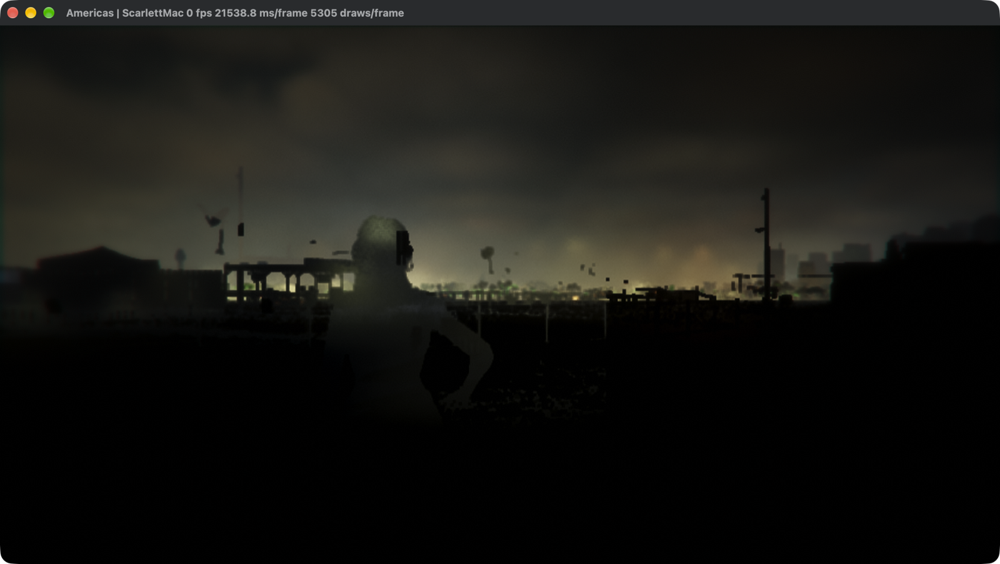
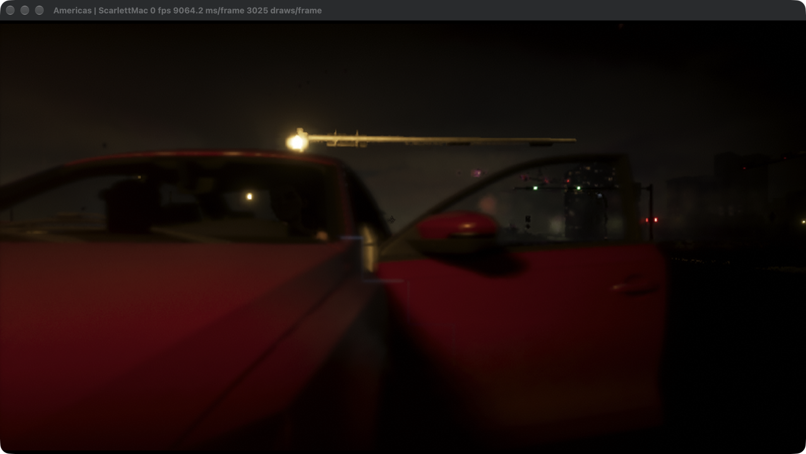
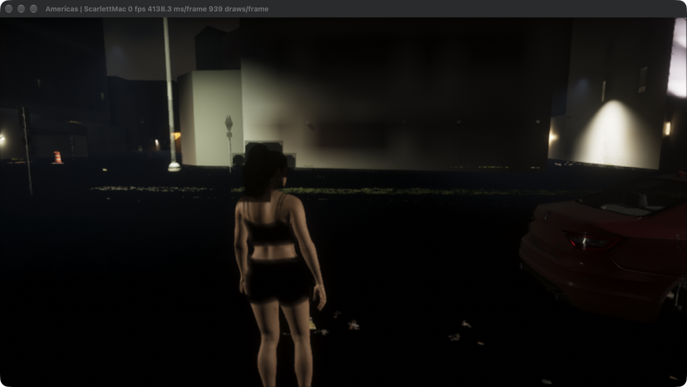

# ScarlettMac

<p align="center">
  <a href="#tested-on-mac"></a>
  <a href="#tested-on-mac"></a>
  <a href="#captured-on-mac"></a>
  <a href="https://discord.gg/EJKCj64geW"></a>
</p>

<a name="captured-on-mac"></a>

<a name="latest-captures"></a>

## Major breakthroughs on Apple Silicon

<p align="center">
  <br>
  <sub>November 26, 2026</sub>
</p>

<table>
  <tr>
    <td width="50%" align="center">
      <a href="assets/captures/prologue-character-close-up.png"></a>
    </td>
    <td width="50%" align="center">
      <a href="assets/captures/night-street-scene.png"></a>
    </td>
  </tr>
  <tr>
    <td align="center"><strong>Opening character close-up</strong><br>Series S opening rendered on an M3 Max MacBook Pro.</td>
    <td align="center"><strong>Night street scene</strong><br>Third-person view of the character, car, and street lighting.</td>
  </tr>
</table>

> [!WARNING]
> **In development.** GTA VI gameplay is currently unavailable. Walking and camera control in a visible scene remain unverified.

[Prologue test details](docs/compatibility.md#prologue-rendering-breakthroughs)

## Lit world on an 18 GB M3 Pro with the checkpoint runtime

<sub>November 26, 2026 · MacBook Pro, Apple M3 Pro, 18 GB · CrossOver Wine + D3DMetal · 1280×720 output</sub>

The contributor traced missing lighting to compute shaders written for the console’s 64-lane waves. The November 26 checkpoint adds opt-in translation for supported wave reductions, first-lane reads and cross-half lane reads on the Mac’s 32-lane GPU (`VICTORY_WAVE64_REDUCE=1`). The contributor reported 50 distinct dropped compute shaders before the change and 28 with it enabled. [Checkpoint settings](runtime-preview/BUILD.md#november-26-source-checkpoint) · [Contributor’s measurements](https://github.com/paveledits/ScarlettMac/pull/6)

<table>
  <tr>
    <td width="33%" align="center">
      <a href="assets/captures/m3pro-before-wave64-black-geometry.png"></a>
    </td>
    <td width="33%" align="center">
      <a href="assets/captures/m3pro-lit-car-wave64.png"></a>
    </td>
    <td width="33%" align="center">
      <a href="assets/captures/m3pro-lit-street-wave64.png"></a>
    </td>
  </tr>
  <tr>
    <td align="center"><strong>Before</strong><br>Lighting passes refused: black geometry.</td>
    <td align="center"><strong>After</strong><br>Shaded car, paint reflections, street lamp.</td>
    <td align="center"><strong>After</strong><br>Third-person street view, 400 s into the run.</td>
  </tr>
</table>

In the contributor’s 18 GB tests, the title reached about 14 GB of memory footprint, system swap reached 7 to 9 GB, and world frames took 2 to 30 seconds. Interactive gameplay remains unverified. The [measurement guide](docs/runbook.md) describes how to compare runtime logs.

## Earlier captures

These images are from tests that preceded the captures above. They are ordered from newer native-window tests down to the earliest XCL setup screens.

<table>
  <tr>
    <td><a href="assets/captures/development-skyline.png"></a><br><strong>Skyline after shader fixes</strong><br>An earlier native-window run drew part of the skyline after shader fixes. Lighting and geometry artifacts were still severe.</td>
    <td><a href="assets/captures/development-pause-menu.png"></a><br><strong>Pause menu during the opening</strong><br>An earlier test opened the pause menu over the live opening. Closing the menu resumed the scene.</td>
  </tr>
  <tr>
    <td><a href="assets/captures/opening-cinematic.png"></a><br><strong>Rendered 3D opening</strong><br>An earlier experimental run rendered a car and driver silhouetted against the sky during the opening replay.</td>
    <td><a href="assets/captures/opening-title-card.png"></a><br><strong>Opening title card</strong><br>The title card appeared after the experimental renderer moved past the loading artwork.</td>
  </tr>
  <tr>
    <td><a href="assets/captures/xcl-loading-artwork.png"></a><br><strong>World loading</strong><br>The earlier XCL build reached world loading, displayed the artwork, and read scene assets.</td>
    <td><a href="assets/captures/setup-menu.png"></a><br><strong>Finish Setup</strong><br>The earlier XCL run reached the end of first-run setup, with Settings, Continue, and Back visible.</td>
  </tr>
  <tr>
    <td><a href="assets/captures/subtitles-menu.png"></a><br><strong>Subtitle settings</strong><br>The earlier XCL setup displayed subtitle settings with Medium selected.</td>
    <td><a href="assets/captures/navigation-menu.png"></a><br><strong>Navigation settings</strong><br>The early XCL setup displayed Navigation Experience with the Dynamic minimap selected.</td>
  </tr>
</table>

[Replay details](docs/compatibility.md#scarlettmac-opening-cinematic) · [Development test results](docs/compatibility.md#recent-development-tests)

ScarlettMac is an experimental Xbox Series X|S compatibility project for Apple Silicon Macs. The XCL build and ScarlettMac Runtime Preview both run through CrossOver. [XCL](https://github.com/xcl-dev/xcl)

[Build and run XCL](#build-and-run) · [ScarlettMac Runtime Preview](runtime-preview/BUILD.md) · [Compatibility results](docs/compatibility.md)

## GTA VI status

| Build tested on M3 Max | Latest verified result |
| --- | --- |
| ScarlettMac XCL | First-run menus accepted controller input. The game reached world loading and read scene assets. |
| ScarlettMac Runtime Preview checkpoint | Confirmed the offline player picker from a launcher marker and reached story loading. The game stopped during a timing check. |
| ScarlettMac development builds | Rendered the Prologue yard and reached the movement tutorial. The game read both sticks at the tutorial. A separate Gone Fishing replay reached its first heavy 3D frame. Both scenes were overexposed. Walking and camera control remain unverified. |
| Local Cool Fox experiments | Rendered a lit street and a character close-up during the opening. Later trials hit a D3DMetal read fault. |

[Latest native-window tests](docs/compatibility.md#november-26-and-27-native-window-tests) · [Runtime checkpoint](docs/compatibility.md#scarlettmac-runtime-preview-checkpoint) · [Cool Fox graphics tests](docs/compatibility.md#cool-fox-graphics-experiments)

### XCL launch milestones

<picture>
  <source media="(max-width: 480px) and (prefers-color-scheme: dark)" srcset="assets/gta-launch-milestones-mobile-dark.svg">
  <source media="(max-width: 480px) and (prefers-color-scheme: light)" srcset="assets/gta-launch-milestones-mobile-light.svg">
  <source media="(prefers-color-scheme: dark)" srcset="assets/gta-launch-milestones-dark.svg">
  <source media="(prefers-color-scheme: light)" srcset="assets/gta-launch-milestones-light.svg">
  
</picture>

[Compatibility measurements and reproduction steps](docs/compatibility.md)

## Contribute

Join the [ScarlettMac Discord](https://discord.gg/EJKCj64geW) to share progress, compare test results, and chat with contributors.

> [!IMPORTANT]
> Help test ScarlettMac on more Apple Silicon Macs. You can run the synthetic Xbox test title, report a compatibility result, or improve the setup instructions. [Contributor guide](CONTRIBUTING.md) · [Open a report](https://github.com/paveledits/ScarlettMac/issues/new/choose)

## How it works

<picture>
  <source media="(prefers-color-scheme: dark)" srcset="assets/compatibility-flow-dark.svg">
  <source media="(prefers-color-scheme: light)" srcset="assets/compatibility-flow-light.svg">
  
</picture>

XCL supplies Xbox system services. Rosetta 2 runs the game’s x64 code, and D3DMetal runs the translated graphics on the Mac GPU.

## Tested on Mac

Apple M3 Max with CrossOver Preview 27.0.0.41073 and D3DMetal 4.0b3.

| Test | Result |
| --- | --- |
| GTA VI on XCL | Menus and world loading reached |
| Xbox system checks | 43, 44, and 43 of 50 passed |
| TuxBox Lanes | Scripted replay passed with input and rendered-board checks |

[Measurements, known issues, and reproduction steps](docs/compatibility.md)

## Build and run

Use an Apple Silicon Mac with CrossOver Preview and create a dedicated Windows 11 64-bit bottle named `ScarlettLab` with D3DMetal enabled. Keep the executable and accompanying unpacked game files together in their original directory structure. [CrossOver](https://www.codeweavers.com/crossover)

Install Rust through rustup, extract LLVM-MinGW 20261117 for macOS, and extract the x64 DLLs from a DirectX Shader Compiler release. The reported build used Rust 1.92.0. [Rust](https://rustup.rs/) · [LLVM-MinGW](https://github.com/mstorsjo/llvm-mingw/releases/tag/20261117) · [DXC](https://github.com/microsoft/DirectXShaderCompiler/releases)

```sh
rustup target add --toolchain stable x86_64-pc-windows-gnullvm
export SCARLETT_LLVM_MINGW=/path/to/llvm-mingw
export SCARLETT_DXC_DIR=/path/to/dxc/bin/x64
scripts/build.sh
scripts/run.sh --inspect /path/to/unpacked/game.exe
scripts/run.sh /path/to/unpacked/game.exe
```

Set `SCARLETT_BOTTLE_DIR` to use a dedicated bottle in another location. Set `SCARLETT_OPUS_DLL` to an x64 `libopus-0.dll` to enable the Opus decoder. The launcher stores local data in the bottle under `C:\scarlett-lab-data` and runs with outbound IP traffic disabled.

Set `SCARLETT_CROSSOVER_APP` to select a different CrossOver app bundle. The launcher accepts an absolute path or a path relative to the directory you run it from. [Launcher fix](https://github.com/paveledits/ScarlettMac/pull/2)

The repository distributes project source, patches, and launcher scripts. Supply your own unpacked game files. [Source provenance](SOURCE-NOTICES.md)

## ScarlettMac Runtime Preview

The preview builds from pinned VIctory-macOS source. The November 26 checkpoint accepts an offline-picker confirmation marker, checks mesh pipelines against Metal’s output limit, and offers an input trace for testing in-world controls. The November 27 performance recipe reaches about 4 fps in the intro's game world on a 24 GB M5 Pro, up from about 1 fps. [Build and verify ScarlettMac Runtime Preview](runtime-preview/BUILD.md)

## Credits and license

This project builds on XCL by ivall and the macOS work by utkarshxdev. [ivall/xcl](https://github.com/ivall/xcl), [utkarshxdev/xcl-mac](https://github.com/utkarshxdev/xcl-mac)

The XCL-derived patches use [GPL-2.0-only](LICENSE). ScarlettMac Runtime Preview uses [GPL-3.0-or-later](runtime-preview/LICENSE) and credits [VIctory-macOS](https://github.com/pragyaangaur/VIctory-macOS).
